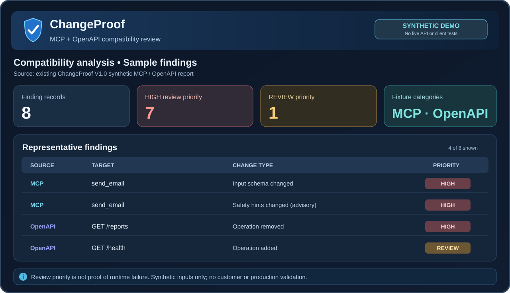

# ChangeProof

### Catch breaking MCP and OpenAPI changes before they reach your users.

**Independent, evidence-backed contract reviews for API teams, AI-agent developers and MCP maintainers.**

Compare two versions of a public or sanitized interface. Understand **what changed**, **which callers may be affected**, and **what to test before rollout** — with a reviewed, source-linked report instead of an opaque PASS/FAIL.

**[Request a scoped review & quote](https://github.com/jajazpua/ChangeProof/issues/new?template=quote-request.yml)** · **[See a sample report](demo/README.md)** · [Start a focused free pilot](https://changeproof-agent-checks.russet-spark-1861.chatgpt.site/#/pilot)

> **Service today:** supervised contract analysis and manual review. No unattended hosted analysis API or automated checkout. Share only public or sanitized material; pricing and delivery terms are agreed before paid work.

---

## A review you can act on

| You need to know… | ChangeProof can help you inspect… |
| --- | --- |
| **Will an MCP agent still call this tool?** | Tool additions/removals, newly required arguments, input/output schema changes, enum drift and advisory metadata. |
| **What changed in this OpenAPI release?** | Removed or added operations, request/response structure, required and nullable fields, referenced models and contract-level risk candidates. |
| **Where should the engineering team focus?** | The exact affected interface locations, before/after evidence, review priorities and targeted downstream tests. |

**Your deliverable:** a human-readable compatibility assessment with traceable findings, relevant input hashes when available, and practical verification steps. Structured JSON and an HTML report can be included when supported and agreed for the scoped engagement.

## Preview the deliverable

**[Open the report demo](demo/README.md)** · [Inspect the synthetic JSON findings](demo/findings.json) · [Read the original sample](ChangeProof_Sample_Compatibility_Report.md)

*The preview is based on an existing **synthetic** sample with eight recorded findings. It demonstrates presentation and contract reasoning, not a live customer test, accuracy benchmark or proof of eight runtime failures. GitHub displays the HTML file as source; the demo guide explains how to open it locally.*

## Public evidence you can inspect

We publish the inputs, reasoning and limitations available for each case. These are **technical investigations and open-source contributions, not customer testimonials or vendor endorsements**.

| Case | Public evidence |
| --- | --- |
| **UniFi Network API** — version 10.4.57 → 11.0.97 | [OpenAPI compatibility report](ChangeProof_UniFi_68_Validated_Pilot_Report.md) identifying the switch-stack response migration and related model changes. Static analysis; no confirmed production client failure. |
| **Apache ShenYu** — MCP contract changes | [Reproducible synthetic regression fixture](pilots/shenyu-7935/README.md) with recorded ChangeProof findings and independent checks; [upstream PR #8309](https://github.com/apache/shenyu/pull/8309). Not a deployed runtime integration. |
| **Denkeeper** — descriptor drift | [Synthetic MCP fixture and analysis](pilots/denkeeper-583/README.md) covering schema, output and annotation changes; 44 scoped offline checks reported. Not a Denkeeper runtime test. |
| **Playwright MCP** — schema export audit | [Manual source-linked review](https://github.com/jajazpua/ChangeProof/blob/415a46e13ab2c132ecfde931ddb7ecf5f081117b/pilots/playwright-mcp-1828/README.md); **not** a ChangeProof engine run. |

**[View the complete evidence and case-study index](docs/PUBLIC_EVIDENCE.md)**

## Choose the right engagement

| | **Free compatibility pilot** | **Scoped paid review** |
| --- | --- | --- |
| **Best for** | One focused question about two public/sanitized MCP or OpenAPI versions. | A release or migration decision involving multiple changes, interfaces or higher review effort. |
| **Scope** | A limited supervised assessment, subject to suitability and capacity. | Agreed deliverables, comparison boundaries and report format before work starts. |
| **How to start** | **[Request a free pilot](https://changeproof-agent-checks.russet-spark-1861.chatgpt.site/#/pilot)** | **[Request a quote](https://github.com/jajazpua/ChangeProof/issues/new?template=quote-request.yml)** |

**Need a price?** Describe the contract type, two versions (or public repository revisions), the change you are planning, and the question the review should answer. We will scope the work and agree a price and delivery terms manually. A quote request does not create an order or collect payment.

## How it works

1. **Tell us the decision.** For example: “Can existing clients safely adopt this OpenAPI update?” or “Will an old agent call the new MCP tool schema?”
2. **Provide a BEFORE and AFTER definition.** Public or sanitized JSON/YAML, release links or revision identifiers are sufficient for initial scoping. No credentials or production access.
3. **Confirm scope and price (if paid).** The review is performed under owner supervision; findings are checked before delivery.
4. **Use the evidence.** Receive a scoped report and focused test recommendations. Validate actual application behavior with your own integration tests.

## Straight answers

**Is this a SaaS or an automated MCP endpoint?**  
Not yet. ChangeProof currently offers an owner-supervised analysis workflow, with manually reviewed requests and results.

**Does a HIGH finding prove production breakage or a security vulnerability?**  
No. Findings identify structural risks and review priorities. Runtime behavior, permissions and downstream failures require their own tests.

**Can you guarantee that generated SDKs will compile?**  
No. OpenAPI changes can suggest risks for generated clients, but generator-specific type-system compatibility and compiled SDK behavior must be tested separately.

**Can I send private contracts or credentials through GitHub Issues?**  
No. GitHub Issues are public. Share only public or sanitized material; do not post tokens, personal data, confidential API definitions or payment details.

---

### Have an MCP or OpenAPI change to review?

**[Get a scoped compatibility review & quote](https://github.com/jajazpua/ChangeProof/issues/new?template=quote-request.yml)** · [Try a focused free pilot](https://changeproof-agent-checks.russet-spark-1861.chatgpt.site/#/pilot) · [Explore the technical evidence](docs/PUBLIC_EVIDENCE.md)

ChangeProof is a proprietary, owner-operated analysis product. This repository publishes product information and selected evidence, not the private backend. SHA-256 values identify the exact supplied bytes, not their upstream authenticity.
