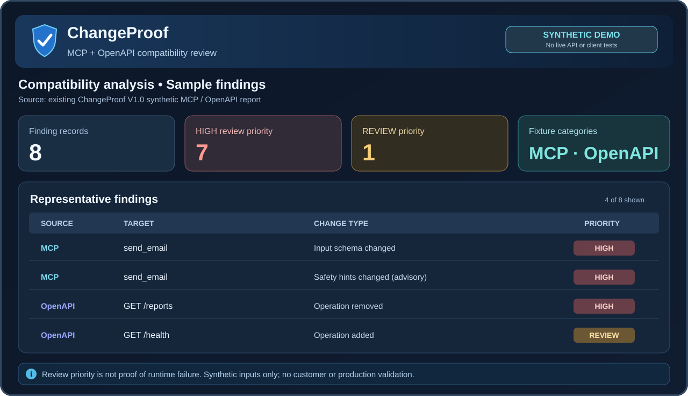

# ChangeProof — HTML report demo

**Synthetic demonstration only:** This is a presentational HTML view of findings already published in [ChangeProof's sample report](../ChangeProof_Sample_Compatibility_Report.md). It uses two synthetic fixture categories (MCP and OpenAPI), with **8 finding records: 7 HIGH review-priority items and 1 REVIEW item**. No new ChangeProof engine run, production API call, customer test or independent accuracy benchmark was performed for this presentation.

## Open the full HTML report

GitHub shows the **source code** of `.html` files rather than hosting them as live pages. To view this standalone report as designed:

1. Open **[ChangeProof_Compatibility_Demo.html](ChangeProof_Compatibility_Demo.html)**.
2. Select **Download raw file** (or use **[Raw HTML](https://raw.githubusercontent.com/jajazpua/ChangeProof/main/demo/ChangeProof_Compatibility_Demo.html)** and save the file as `ChangeProof_Compatibility_Demo.html`).
3. Open the saved `.html` file in a browser. No server, script, account, external CSS, or network access is required to display it.
4. Use your browser's **Print → Save as PDF** if you want a PDF view.

The `findings.json` companion file is available below. It repeats the reported synthetic finding records and recommended follow-up tests, with an explicit non-runtime evidence scope.

**[View the HTML file](ChangeProof_Compatibility_Demo.html)** · **[View the JSON findings](findings.json)** · **[Read the original Markdown sample](../ChangeProof_Sample_Compatibility_Report.md)**

## What is demonstrated

- An executive summary separating findings from runtime proof.
- MCP tool description/input-schema/annotation drift.
- OpenAPI added/removed operations, referenced schema and security-definition changes.
- Review-priority labels, complete input SHA-256 strings *as recorded in the original sample*, and focused test recommendations.
- Clear limits: **synthetic inputs**, no production call, no customer endorsement, no automated payment.

The report is a static layout sample. It does not authenticate input file provenance or imply that all findings are independent breaking changes.

**[Request a free supervised pilot](https://changeproof-agent-checks.russet-spark-1861.chatgpt.site/#/pilot)** · **[Request a scoped quote](https://github.com/jajazpua/ChangeProof/issues/new?template=quote-request.yml)**
